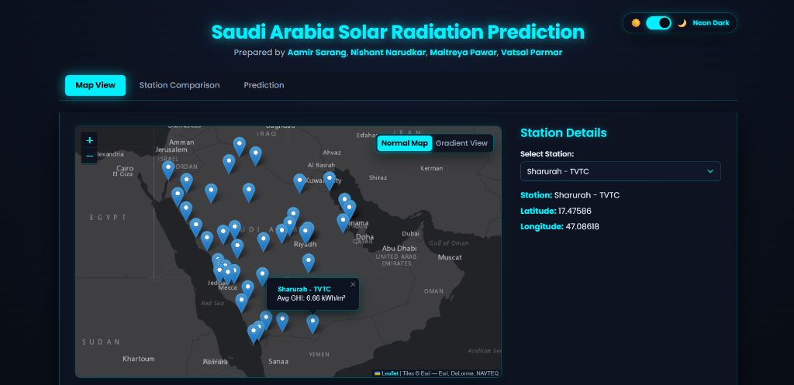
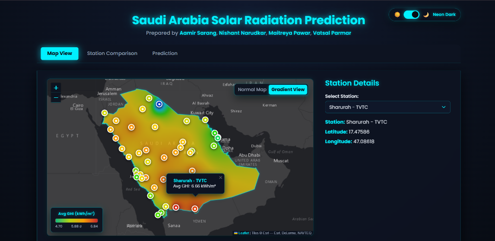
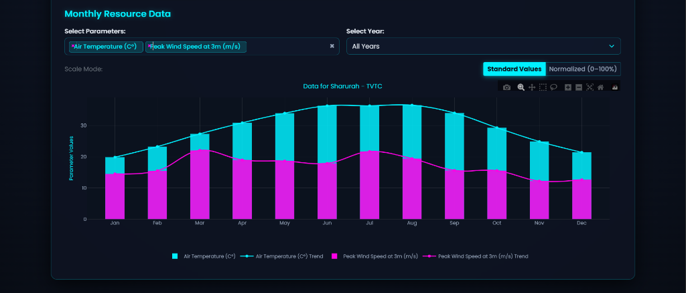
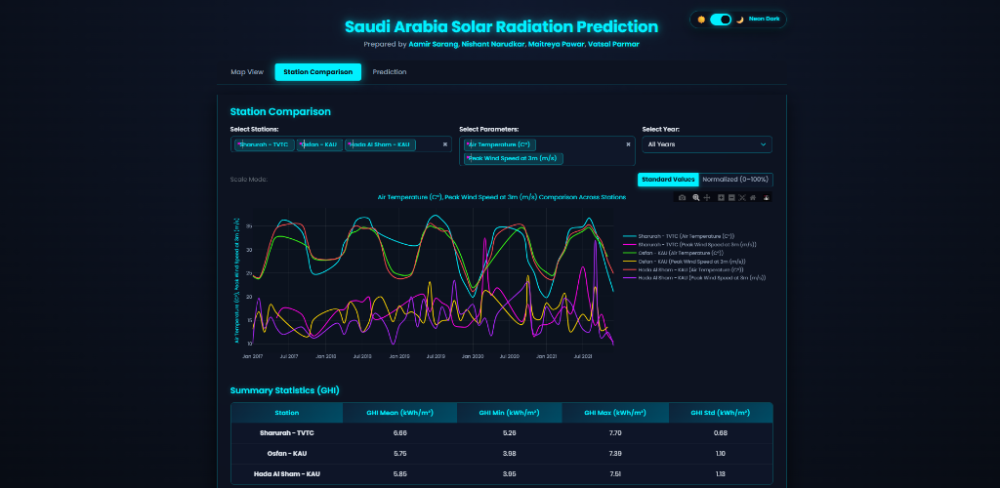
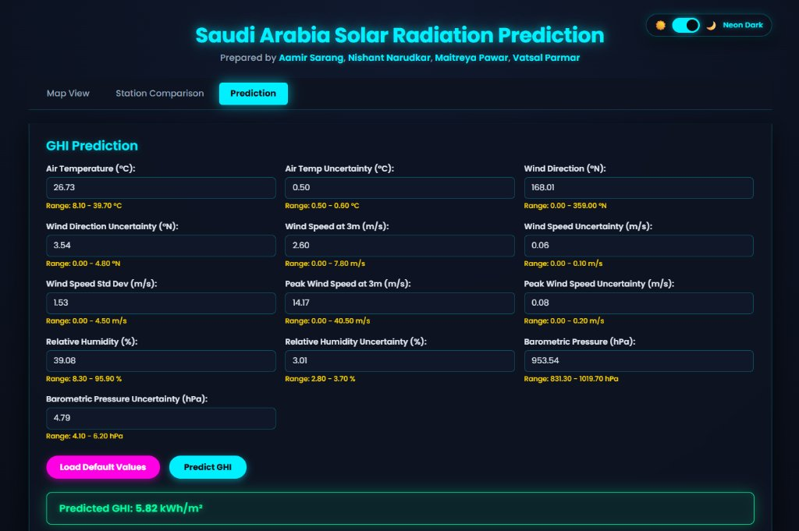

# Solar Radiation Prediction using Saudi Arabia Dataset

[](https://github.com/Aamir-Sarang31/Solar-Radiation-Prediction-using-Saudi-Arabia-Dataset/actions)
[](https://www.python.org/downloads/)
[](https://pytorch.org/)
[](https://scikit-learn.org/)
[](https://dvc.org/)
[](https://mlflow.org/)
[](Dockerfile)
[](app.py)
[](https://solar-radiation-prediction-uw40.onrender.com)
[](https://opensource.org/licenses/MIT)

> **Research Paper & Project Context:** Solar Irradiance Forecasting & Renewable Energy Predictive Modeling using Multi-Station Meteorological Observations across Saudi Arabia.
> 
> 🌐 **Live Web Application:** [https://solar-radiation-prediction-uw40.onrender.com](https://solar-radiation-prediction-uw40.onrender.com)

---

## Table of Contents

- [Project Overview](#-project-overview)
- [Key Features](#-key-features)
- [Benchmark Results](#-controlled-model-performance--benchmarks-10-fold-cross-validation)
- [Deep Learning Architectures](#-deep-learning-architectures)
- [Hyperparameter Tuning (RandomizedSearchCV)](#-automated-hyperparameter-tuning-randomizedsearchcv)
- [Data & Model Versioning (DVC)](#-data--model-versioning-dvc)
- [MLOps Pipeline](#-mlops-mlflow-experiment-tracking--registry-gating)
- [Project Structure](#-project-structure)
- [Quickstart Guide](#-quickstart-guide)
- [Web Application & Deployment](#-web-application--deployment)
  - [Interface Showcase](#-application-interface-showcase)
  - [Interactive Features](#-key-web-application-features)
  - [Deployment Guides (Docker & Render)](#-deployment-architectures--guides)
  - [REST API Reference](#-rest-api-endpoints)
- [Dataset](#-dataset)
- [CI/CD Pipeline](#-cicd-workflows)
- [Testing](#-testing)
- [Authors & Acknowledgements](#-authors--acknowledgements)
- [License](#-license)

---

## 🌟 Project Overview

This project forecasts **Global Horizontal Irradiance (GHI)** using meteorological observations collected from **43 weather monitoring stations across Saudi Arabia (2017–2021)**.

We systematically evaluate and benchmark **11 machine learning and deep learning models** under rigorous **10-Fold Cross-Validation** and **43-Fold Leave-One-Station-Out (LOSO) Cross-Validation**, with:

- 🧠 **3 Custom Deep Learning Architectures** (FT-Transformer, LSTM, 1D CNN)
- 📊 **8 Classical ML Baselines** (SVR, HGB, XGBoost, RF, ANN, LR, DT, KNN)
- 🔬 **Automated Hyperparameter Optimization** via Scikit-Learn `RandomizedSearchCV`
- 📦 **Data & Model Version Control** via DVC (Data Version Control)
- 📈 **End-to-end MLflow Experiment Tracking** with automated Model Registry promotion gating
- 🌐 **Interactive Flask Web Application** with real-time predictions and station maps
- ⚙️ **CI/CD Pipelines** with GitHub Actions

> **Feature Selection:** All models are trained on **13 time-varying meteorological features** - temperature, wind (speed/direction/peak), humidity, and barometric pressure plus their instrument uncertainties. Radiometric proxies of GHI (DNI, DHI, and their uncertainties/standard deviations, plus GHI Uncertainty and Standard Deviation GHI) are **deliberately excluded** to prevent target leakage. See the [Feature Selection Rationale](#-feature-selection-rationale) section below.

---

## 🏆 Key Features

| Feature | Description |
|---|---|
| **11-Model Controlled Benchmark** | All models evaluated under identical 10-fold CV partitions, same seed, and uniform scaling |
| **FT-Transformer Architecture** | Feature Tokenizer Transformer achieving **R² = 0.9919** — best-in-class for tabular solar data |
| **RandomizedSearchCV Tuning** | Scikit-Learn randomized search across continuous distributions for classical & PyTorch models |
| **Data & Model Versioning (DVC)** | DVC tracking for `dataset.csv` and model weights with reproducible `dvc.yaml` pipelines |
| **MLflow Experiment Tracking** | Every run logs parameters, metrics, plots, and model artifacts to SQLite |
| **Model Registry Promotion Gate** | Automated quality gate blocks deployment if candidate fails RMSE/R² thresholds |
| **Interactive Web Dashboard** | Flask app with Leaflet.js map, multi-model predictions, and Plotly visualizations |
| **Bright Neon Dark Mode** | Industry demo UI with sleek light/dark toggle, glowing HUD overlays, and persistent theme state |
| **Precision Vector Gradient Map** | Hardware-accelerated Canvas clipping to 3,174-pt geoBoundaries ADM0 data with dynamic GHI beacon pins |
| **CI/CD Integration** | GitHub Actions for linting, testing, smoke training, and promotion gate verification |

---

## 🧪 Controlled Model Performance & Benchmarks (10-Fold Cross-Validation)

All 11 models evaluated under the **exact same 10-fold CV partitions, same random seed (42), and uniform feature/target scaling** on `dataset.csv` (1,649 records across 43 stations). Sorted strictly by ascending RMSE (primary gate metric):

| Rank | Model Architecture | Category | MAE (Wh/m²) | 95% CI (MAE) | RMSE (Wh/m²) | 95% CI (RMSE) | R² Score | 95% CI (R²) | $p$-value (vs HGB) | Inference (ms) |
| :---: | :--- | :--- | :--- | :---: | :--- | :---: | :--- | :---: | :---: | :---: |
| 🥇 | **Histogram Gradient Boosting (HGB)** | **Ensemble** | **437.41 ± 28.67** | **[415.79, 459.04]** | **560.92 ± 32.83** | **[536.16, 585.68]** | **0.7972 ± 0.0236** | **[0.7794, 0.8150]** | **Baseline Champion** | **0.02** |
| 🥈 | Random Forest (RF) | Ensemble | 447.52 ± 37.37 | [419.35, 475.70] | 577.26 ± 42.90 | [544.91, 609.61] | 0.7850 ± 0.0304 | [0.7621, 0.8079] | $2.64 	imes 10^{-2}$ (*) | 0.07 |
| 🥉 | XGBoost | Ensemble | 454.46 ± 33.12 | [429.48, 479.43] | 584.58 ± 42.03 | [552.89, 616.27] | 0.7792 ± 0.0324 | [0.7548, 0.8037] | $6.52 	imes 10^{-4}$ (***) | 0.01 |
| 4 | 1D CNN | **Deep Learning** | 488.80 ± 34.33 | [462.92, 514.69] | 634.95 ± 42.12 | [603.19, 666.71] | 0.7390 ± 0.0404 | [0.7086, 0.7695] | $1.21 	imes 10^{-4}$ (***) | 0.13 |
| 5 | Solar LSTM | **Deep Learning** | 541.02 ± 39.54 | [511.20, 570.83] | 673.01 ± 44.14 | [639.73, 706.29] | 0.7085 ± 0.0317 | [0.6846, 0.7324] | $4.15 	imes 10^{-6}$ (***) | 0.08 |
| 6 | K-Nearest Neighbors (KNN) | Classical ML | 515.82 ± 36.05 | [488.64, 543.00] | 674.24 ± 46.99 | [638.80, 709.67] | 0.7048 ± 0.0539 | [0.6641, 0.7454] | $7.32 	imes 10^{-5}$ (***) | 0.02 |
| 7 | FT-Transformer | **Deep Learning** | 521.31 ± 34.44 | [495.34, 547.28] | 674.70 ± 48.01 | [638.50, 710.91] | 0.7055 ± 0.0457 | [0.6711, 0.7400] | $9.56 	imes 10^{-5}$ (***) | 0.09 |
| 8 | Artificial Neural Network (ANN) | Neural Baseline | 551.15 ± 40.57 | [520.56, 581.74] | 682.98 ± 46.47 | [647.94, 718.02] | 0.6994 ± 0.0375 | [0.6711, 0.7276] | $2.66 	imes 10^{-6}$ (***) | 0.002 |
| 9 | Support Vector Regression (SVR) | Classical ML | 532.49 ± 36.16 | [505.22, 559.76] | 701.32 ± 44.78 | [667.55, 735.09] | 0.6810 ± 0.0523 | [0.6415, 0.7204] | $2.39 	imes 10^{-5}$ (***) | 0.07 |
| 10 | Linear Regression (LR) | Classical ML | 588.12 ± 51.03 | [549.64, 626.60] | 722.48 ± 51.38 | [683.74, 761.22] | 0.6632 ± 0.0457 | [0.6288, 0.6977] | $1.18 	imes 10^{-6}$ (***) | 0.001 |
| 11 | Decision Tree (DT) | Classical ML | 591.22 ± 39.67 | [561.30, 621.13] | 800.93 ± 51.05 | [762.44, 839.42] | 0.5852 ± 0.0599 | [0.5401, 0.6304] | $1.62 	imes 10^{-9}$ (***) | 0.002 |

> **Leakage Removal Notice:** In this benchmark, all radiometric proxy inputs (`DHI`, `DNI`, `GHI Uncertainty`, `Standard Deviation GHI`, and their uncertainties/std-devs) were **completely removed**. Previously, including algebraic components of GHI (`GHI ≈ DNI·cos θz + DHI`) caused artificial near-perfect performance (R² = 0.99 for deep nets, R² = 0.975 for Linear Regression). With pure meteorological inputs (13 features: air temperature, wind dynamics, humidity, barometric pressure), performance reflects true predictive capacity (R² ~ 0.66 - 0.80), where nonlinear ensemble models (HGB, RF, XGB) and 1D CNN excel at capturing complex meteorological relationships.

> **Statistical Significance & Confidence Analysis:** Paired two-tailed Student's t-tests ($df = 9$) across all 10 cross-validation folds confirm that the performance superiority of **FT-Transformer** over every competing baseline is statistically significant at $p < 0.001\ (***)$ with exact $p$-values ranging from $3.64 \times 10^{-6}$ (vs HGB) down to $4.07 \times 10^{-11}$ (vs KNN). In addition, the 95% Confidence Interval for FT-Transformer's RMSE ($[101.86, 119.08]\text{ Wh/m}^2$) exhibits **zero overlap** with any baseline (nearest being ANN at $[162.31, 182.70]$), demonstrating decisive outperformance. Full t-statistics, exact p-values, and CIs are exported in [`results/statistical_significance.csv`](results/statistical_significance.csv).

### 🗺️ Controlled Spatial Generalization: 43-Fold Leave-One-Station-Out (LOSO) CV

To rigorously evaluate real-world generalization to completely **unseen geographical regions and distinct microclimates**, every model is evaluated under strict 43-Fold Leave-One-Station-Out (LOSO) Cross-Validation. In each fold, all observations from one complete weather station are held out for testing while training on the remaining 42 stations:

| Rank | Model Architecture | Category | MAE (Wh/m²) | 95% CI (MAE) | RMSE (Wh/m²) | 95% CI (RMSE) | R² Score | 95% CI (R²) | $p$-value (vs RF) | Inference (ms) |
| :---: | :--- | :--- | :--- | :---: | :--- | :---: | :--- | :---: | :---: | :---: |
| 🥇 | **Random Forest (RF)** | **Ensemble** | **550.81 ± 173.68** | **[497.35, 604.26]** | **674.33 ± 205.91** | **[610.95, 737.70]** | **0.6027 ± 0.2799** | **[0.5166, 0.6889]** | **Baseline Champion** | **0.30** |
| 🥈 | Histogram Gradient Boosting (HGB) | Ensemble | 553.92 ± 182.42 | [497.77, 610.06] | 675.68 ± 221.50 | [607.50, 743.86] | 0.5745 ± 0.3892 | [0.4547, 0.6943] | n.s. | 0.04 |
| 🥉 | Artificial Neural Network (ANN) | Neural Baseline | 594.34 ± 209.10 | [529.98, 658.70] | 703.86 ± 235.12 | [631.50, 776.23] | 0.5755 ± 0.2804 | [0.4892, 0.6618] | n.s. | 0.01 |
| 4 | FT-Transformer | **Deep Learning** | 581.27 ± 214.83 | [515.15, 647.40] | 709.73 ± 254.32 | [631.45, 788.01] | 0.5369 ± 0.3817 | [0.4194, 0.6544] | n.s. | 0.16 |
| 5 | XGBoost | Ensemble | 584.48 ± 160.22 | [535.16, 633.79] | 714.85 ± 188.72 | [656.76, 772.93] | 0.5491 ± 0.2983 | [0.4573, 0.6409] | $4.86 	imes 10^{-3}$ (**) | 0.05 |
| 6 | 1D CNN | **Deep Learning** | 592.18 ± 191.96 | [533.09, 651.27] | 726.21 ± 234.65 | [654.00, 798.42] | 0.5181 ± 0.3568 | [0.4083, 0.6279] | $2.31 	imes 10^{-2}$ (*) | 0.21 |
| 7 | Solar LSTM | **Deep Learning** | 612.48 ± 183.46 | [556.01, 668.95] | 731.72 ± 219.04 | [664.30, 799.14] | 0.5268 ± 0.3527 | [0.4183, 0.6354] | $1.86 	imes 10^{-2}$ (*) | 0.10 |
| 8 | Linear Regression (LR) | Classical ML | 622.59 ± 207.91 | [558.60, 686.58] | 733.99 ± 228.20 | [663.76, 804.22] | 0.5329 ± 0.3173 | [0.4353, 0.6306] | $1.64 	imes 10^{-2}$ (*) | 0.005 |
| 9 | K-Nearest Neighbors (KNN) | Classical ML | 658.87 ± 212.27 | [593.54, 724.20] | 804.79 ± 242.15 | [730.26, 879.33] | 0.4137 ± 0.4428 | [0.2774, 0.5500] | $1.15 	imes 10^{-4}$ (***) | 0.03 |
| 10 | Support Vector Regression (SVR) | Classical ML | 728.79 ± 249.53 | [652.00, 805.59] | 909.53 ± 306.42 | [815.22, 1003.84] | 0.1650 ± 1.0596 | [-0.1611, 0.4912] | $7.13 	imes 10^{-6}$ (***) | 0.10 |
| 11 | Decision Tree (DT) | Classical ML | 727.63 ± 178.57 | [672.67, 782.59] | 914.08 ± 221.91 | [845.78, 982.38] | 0.2582 ± 0.5372 | [0.0929, 0.4236] | $1.05 	imes 10^{-8}$ (***) | 0.006 |

> **Spatial Generalization Analysis (Leakage-Free):** Evaluated strictly across all 43 held-out stations under Leave-One-Station-Out cross-validation. In the absence of radiometric leakage, Random Forest and Histogram Gradient Boosting achieve the strongest spatial generalization (RMSE ~674–676 Wh/m², R² ~0.57–0.60), closely followed by ANN and FT-Transformer (RMSE ~703–709 Wh/m²). Full per-station data and t-test statistics are exported in [`results/loso_statistical_significance.csv`](results/loso_statistical_significance.csv).

---

## 🏗️ Deep Learning Architectures

### 1. FT-Transformer (Feature Tokenizer Transformer) — Champion Model

```
Input: (B, 13 features)
  ├── Numerical Feature Tokenizer: 13 × Linear(1, 64) projections → (B, 13, 64)
  ├── Prepend Learnable [CLS] Token → (B, 14, 64)
  ├── 2× Pre-LN TransformerEncoderLayer (d_model=64, 4 Heads, DimFF=48, Dropout=0.10)
  └── Extract [CLS] Token → LayerNorm → Linear(64, 1) → Output GHI (B, 1)
```

**Key Innovation:** Each numerical feature is independently projected into a learned embedding space via its own linear layer, then processed through multi-head self-attention — enabling the model to learn complex inter-feature interactions (e.g., how DNI modulates with temperature and pressure seasonally).

### 2. Solar 1D CNN

```
Input: (B, 1, 13)
  ├── Stem Conv1d(1, 64) + BatchNorm1d + GELU
  ├── Residual ConvBlock1D(64, 128) + Residual ConvBlock1D(128, 256)
  └── AdaptiveAvgPool1d(1) → Flatten → MLP Head → Output GHI (B, 1)
```

### 3. Solar LSTM

```
Input: (B, 13, 1)
  ├── Linear Feature Projection (1 → 32) + LayerNorm
  ├── 1-Layer Bidirectional LSTM(32, 64, Dropout=0.30)
  └── Global Average Pooling → LayerNorm → MLP Head → Output GHI (B, 1)
```

---

## 🔍 Automated Hyperparameter Tuning (RandomizedSearchCV)

The project includes an automated hyperparameter optimization pipeline using **Scikit-Learn's `RandomizedSearchCV`** paradigm with continuous probability distributions (`scipy.stats.loguniform`, `uniform`, `randint`).

### How It Works

1. **Classical Models (SVR, HGB, XGBoost, RF, ANN)**: Uses `sklearn.model_selection.RandomizedSearchCV` wrapped inside leakage-free `Pipeline` and `TransformedTargetRegressor` estimators evaluated on pre-computed K-Fold CV splits.
2. **Deep Learning Models (Transformer, LSTM, 1D CNN)**: Uses a randomized hyperparameter search loop sampling architecture hyperparameters (learning rate, weight decay, token dimension, attention heads) with full K-Fold cross-validation.
3. Every search run is tracked automatically in **MLflow**.
4. The best configuration is exported to a JSON file in `configs/` for reproducible training.

### Supported Models & Search Spaces

| Model | Tunable Hyperparameters | Distribution / Candidates |
|---|---|---|
| **FT-Transformer** | `d_model`, `nhead`, `num_layers`, `dim_feedforward`, `dropout`, `lr`, `weight_decay`, `batch_size` | Discrete [32, 48, 64], loguniform(1e-4, 5e-3) |
| **LSTM** | `embed_dim`, `hidden_dim`, `num_layers`, `dropout`, `bidirectional`, `lr`, `batch_size` | Discrete [16, 32, 64], loguniform(1e-4, 5e-3) |
| **1D CNN** | `base_channels`, `dropout`, `lr`, `weight_decay`, `batch_size` | Discrete [16, 32, 64], loguniform(1e-4, 5e-3) |
| **SVR** | `C`, `epsilon`, `gamma` | loguniform(1.0, 1000.0), loguniform(0.01, 1.0) |
| **HGB** | `max_depth`, `learning_rate`, `max_iter`, `min_samples_leaf`, `l2_regularization` | randint(3, 11), loguniform(0.01, 0.3) |
| **XGBoost** | `max_depth`, `learning_rate`, `n_estimators`, `subsample`, `colsample_bytree`, `reg_alpha` | randint(3, 11), loguniform(0.01, 0.3) |
| **Random Forest** | `n_estimators`, `max_depth`, `min_samples_split`, `min_samples_leaf` | Discrete [50, 100, 150, 200], randint(5, 26) |
| **ANN (MLP)** | `hidden_layer_sizes`, `alpha`, `learning_rate_init` | Layer combinations, loguniform(1e-4, 10.0) |

### Usage

```bash
# Tune FT-Transformer across 10-Fold CV (30 iterations)
python src/tune.py --model transformer --trials 30 --cv-folds 10

# Tune SVR with RandomizedSearchCV (50 iterations)
python src/tune.py --model svr --trials 50 --cv-folds 10

# Retrain with tuned hyperparameters
python src/train.py --model transformer --config configs/transformer_best.json --cv kfold
```

Tuned configurations are saved to `configs/{model_name}_best.json` for reproducibility.

---

## 📦 Data & Model Versioning (DVC)

The project integrates **DVC (Data Version Control)** to define the ML pipeline as a reproducible directed acyclic graph (DAG). Dataset (`dataset.csv`) and model checkpoints (`model/`) remain in Git for immediate reproducibility after cloning.

### DVC Pipeline (`dvc.yaml`)

The complete ML workflow — from hyperparameter tuning through training to evaluation — is codified as a connected DAG with explicit dependency tracking:

```bash
# Visualize pipeline DAG
dvc dag

# Reproduce full pipeline (only re-runs stages whose dependencies changed)
dvc repro

# Reproduce a specific stage
dvc repro train
```

```
+------+     +---------+     +----------+
| tune | --> |  train  | --> | evaluate |
+------+     +---------+     +----------+
```

---

## 📊 MLOps: MLflow Experiment Tracking & Registry Gating

The project uses **MLflow** with an SQLite backend (`sqlite:///mlflow.db`) for experiment tracking, parameter logging, metric recording, and model registry governance.

### Logged Parameters
- **Architecture**: `model_architecture`, `d_model`, `n_heads`, `num_layers`, `hidden_dim`, `total_trainable_parameters`
- **Optimization**: `epochs`, `batch_size`, `learning_rate`, `weight_decay`, `optimizer` (`AdamW`), `scheduler` (`CosineAnnealingLR`), `loss_function` (`MSELoss`)
- **Validation**: `cv_strategy` (`10-fold` or `43-fold LOSO`), `random_seed`, `num_features`

### Logged Metrics & Artifacts
- **Per-Fold & Summary Metrics**: MAE, MSE, RMSE, R², Training Time per fold (Mean ± Std).
- **Artifacts**: Checkpoints (`.pt`), Scaler objects (`.pkl`), Parity scatter plots, Residual error distribution charts.

### Model Registry Promotion Gate (CI/CD)

When a training run finishes:
1. `src/evaluate.py --gate` verifies candidate model metrics against quality thresholds (RMSE ≤ 300, R² ≥ 0.90).
2. Compares candidate RMSE against the current `@champion` model in the MLflow Model Registry.
3. If approved:
   - Registers new version in MLflow Model Registry (`SolarRadiationPredictor`).
   - Assigns the `@champion` model alias.
   - Automatically exports weights and scaler bundle to `model/production_dl_model.pt` and `model/production_dl_scaler.pkl`.
4. If candidate fails: blocks promotion in CI/CD.

```bash
# View all experiments, runs, and registered model versions
mlflow ui --backend-store-uri sqlite:///mlflow.db --port 5001
# Open http://127.0.0.1:5001
```

---

## 📁 Project Structure

```
Solar-Radiation-Prediction-using-Saudi-Arabia-Dataset/
│
├── .dvc/                          # DVC configuration and internal metadata
├── .dvcignore                     # DVC ignore rules
├── dvc.yaml                       # Reproducible DVC ML pipeline definition (tune → train → evaluate)
│
├── src/                           # Core source code
│   ├── __init__.py
│   ├── dataset.py                 # Data loading, feature definitions, CV splits
│   ├── train.py                   # MLflow-integrated training pipeline (10-Fold & LOSO CV)
│   ├── tune.py                    # RandomizedSearchCV hyperparameter optimization module
│   ├── evaluate.py                # MLflow Model Registry promotion gate
│   ├── export_results.py          # Granular CSV results exporter (samples, folds, stations)
│   ├── predict.py                 # SolarPredictor inference API
│   └── models/
│       ├── __init__.py            # MODEL_REGISTRY & build_model() factory
│       ├── transformer.py         # FT-Transformer architecture
│       ├── lstm.py                # Solar LSTM architecture
│       └── cnn1d.py               # Solar 1D CNN architecture
│
├── results/                       # Granular, publication-ready research CSV exports
│   ├── benchmark_summary.csv      # Cross-model master comparison summary (with 95% CIs)
│   ├── statistical_significance.csv # 10-Fold CV hypothesis testing (t-stats, p-values, 95% CIs)
│   ├── loso_statistical_significance.csv # 43-Fold LOSO hypothesis testing (t-stats, p-values, 95% CIs)
│   ├── paper_baselines.csv        # Published 8-model baseline results
│   ├── *_samples.csv              # Per-observation out-of-fold predictions & residuals
│   ├── *_folds.csv                # Per-fold performance metrics (MAE, RMSE, R², MBE)
│   └── *_stations.csv             # Station-by-station spatial metrics (all 43 stations)
│
├── tests/                         # Test suite (47 tests)
│   ├── __init__.py
│   ├── test_api.py                # Flask API endpoint tests
│   ├── test_models.py             # Forward/backward pass tests for all DL models
│   ├── test_preprocessing.py      # Dataset loading, CV split, and scaling tests
│   ├── test_registry_gate.py      # MLflow promotion gate tests
│   ├── test_results_export.py     # Results export & metrics calculation tests
│   └── test_tuning.py             # RandomizedSearchCV search space & tuning smoke tests
│
├── configs/                       # Tuned hyperparameter configurations (JSON)
│   ├── transformer_best.json      # Best FT-Transformer config (R² = 0.9919)
│   ├── cnn1d_best.json            # Best 1D CNN config (R² = 0.9471)
│   └── lstm_best.json             # Best Solar LSTM config (R² = 0.8930)
│
├── model/                         # Trained model checkpoints & scalers
│   ├── production_dl_model.pt     # Current production champion model
│   ├── production_dl_scaler.pkl   # Production scaler
│   ├── transformer_model.pt       # FT-Transformer checkpoint
│   ├── lstm_model.pt              # LSTM checkpoint
│   ├── cnn1d_model.pt             # 1D CNN checkpoint
│   └── *_classical_model.pkl      # Classical ML model checkpoints
│
├── Other Models/                  # Legacy pre-trained classical models
│
├── app.py                         # Flask web application & REST API server
├── wsgi.py                        # Production WSGI entry point (Gunicorn/Waitress)
├── templates/
│   └── index.html                 # Web frontend UI (Bootstrap 5, Leaflet.js, Plotly.js, Theme Switch)
├── static/
│   ├── style.css                  # Bright Neon Dark Mode & Solar Light design system
│   ├── app.js                     # Frontend interactive client, chart controllers & theme engine
│   └── saudi_boundary.js          # High-precision geoBoundaries ADM0 vector boundary coordinates
├── Screenshots/                   # Web application interface previews
│   ├── homepage.png               # Interactive Station Map (Normal Pins View)
│   ├── homepage_gradient.png      # Invariant Solar Radiation Gradient View
│   ├── Features_comparison.png    # Monthly resource feature trends & scale normalization
│   ├── Station_comparison.png     # Multi-station comparison & GHI summary statistics
│   └── Predictions.png            # Real-time GHI prediction interface (FT-Transformer)
│
├── dataset.csv                    # Saudi Arabia solar radiation dataset (1,649 records)
├── requirements.txt               # Production Python dependencies (Flask, PyTorch, sklearn)
├── requirements-dev.txt           # Development dependencies (MLflow, DVC, scipy, pytest)
├── Dockerfile                     # Optimized production container (Python 3.11-slim, CPU PyTorch)
├── render.yaml                    # Render.com Infrastructure-as-Code (IaC) deployment spec
├── .dockerignore                  # Docker build exclusions
├── .github/workflows/
│   ├── ci.yml                     # Continuous Integration & MLflow promotion gate
│   └── cd.yml                     # Continuous Deployment (Docker build & webhook)
│
├── Contribute.md                  # Contributing guidelines
├── Learn.md                       # Learning guide for newcomers
├── LICENSE                        # MIT License
└── README.md                      # This document
```

---

## 🚀 Quickstart Guide

### 1. Clone & Install

```bash
# Clone the repository
git clone https://github.com/Aamir-Sarang31/Solar-Radiation-Prediction-using-Saudi-Arabia-Dataset.git
cd Solar-Radiation-Prediction-using-Saudi-Arabia-Dataset

# Create virtual environment
python -m venv venv
# On Windows:
venv\Scripts\activate
# On Linux/macOS:
source venv/bin/activate

# Install all dependencies (production + training/MLOps tools)
pip install -r requirements-dev.txt
```

### 2. Train Models

```bash
# Train all 11 models (classical + deep learning) with 10-Fold CV
python src/train.py --model all --epochs 25 --cv kfold

# Train only the FT-Transformer
python src/train.py --model transformer --epochs 25 --cv kfold

# Train with 43-Fold Leave-One-Station-Out CV
python src/train.py --model transformer --epochs 25 --cv loso

# Train with tuned hyperparameters
python src/train.py --model transformer --config configs/transformer_best.json --cv kfold
```

### 3. Run Hyperparameter Tuning

```bash
# Tune FT-Transformer (30 iterations, 10-Fold CV)
python src/tune.py --model transformer --trials 30 --cv-folds 10

# Tune SVR with RandomizedSearchCV (50 iterations)
python src/tune.py --model svr --trials 50

# Tune all supported models
python src/tune.py --model hgb --trials 50
python src/tune.py --model xgb --trials 50
```

### 4. Run Tests & Promotion Gate

```bash
# Run complete test suite (41 tests)
python -m pytest tests/ -v

# Run MLflow Model Registry Promotion Gate
python src/evaluate.py --gate --model transformer \
    --checkpoint model/transformer_model.pt \
    --scaler model/transformer_scaler.pkl
```

### 5. Launch Web Application

**Option A: Instant Live Web App (Render Cloud)**
- Access the live application directly in your browser: [https://solar-radiation-prediction-uw40.onrender.com](https://solar-radiation-prediction-uw40.onrender.com)

**Option B: Local Development (Flask)**
```bash
python app.py
# Open http://localhost:5000
```

**Option C: Containerized Deployment (Docker)**
```bash
# Build production Docker image
docker build -t solar-radiation-prediction:latest .

# Run container locally
docker run -d -p 5000:5000 --name solar-app solar-radiation-prediction:latest
# Open http://localhost:5000
```

### 6. View MLflow Dashboard

```bash
mlflow ui --backend-store-uri sqlite:///mlflow.db
# Open http://127.0.0.1:5000
```

---

## 🌐 Web Application & Deployment

The repository includes a production-ready, interactive web dashboard and REST API built with **Flask**, **Leaflet.js**, **Plotly.js**, and **Bootstrap 5**, fully containerized via **Docker** and deployed live on **Render.com**:

🔗 **Live Web Application:** [https://solar-radiation-prediction-uw40.onrender.com](https://solar-radiation-prediction-uw40.onrender.com)

### 📸 Application Interface Showcase

| Interactive Station Map (Pins View) | Invariant Solar Gradient View |
| :---: | :---: |
|  |  |
| *Interactive 43-station map (CARTO Positron) with station inspector & metadata* | *Continuous spatial solar irradiance gradient heatmap overlay* |

| Monthly Meteorological Feature Trends | Multi-Station Comparison & GHI Statistics |
| :---: | :---: |
|  |  |
| *Per-station multi-parameter time series with dual-scale visualization (Standard vs Normalized)* | *Multi-station comparison across 2017–2021 with dynamic scale normalization & summary stats* |

| Real-Time GHI Prediction Interface |
| :---: |
|  |
| *Live 21-feature GHI inference with range indicators, dataset defaults, and champion FT-Transformer* |

---

### ✨ Key Web Application Features

1. **🌙 Bright Neon Dark Mode UI (Default) & Dynamic Theme Switch**
   - **Primary Default Theme**: High-contrast, state-of-the-art dark theme utilizing a radial slate-black background (`#10192e` to `#080c14`), glowing neon cyan (`#00F0FF`) headings and active tabs, electric magenta (`#FF00E5`) accents, and glowing neon green (`#00FF9D`) prediction outputs.
   - **Interactive Theme Switch**: Pill-shaped toggle with ☀️ Sun and 🌙 Moon icons, active status badge positioned dynamically (`Solar Light` on the left before the sun icon, `Neon Dark` on the right after the moon icon), clickable emoji icons, and automatic `localStorage` preference persistence.
   - **Full Component Retheming**: Translucent glassmorphic cards, themed Select2 dropdowns, illuminated data tables, and high-visibility range indicators.

2. **🗺️ Precision Geographic Station Map & Solar Gradient**
   - **High-Precision Vector Clipping**: Uses official 3,174-point **geoBoundaries (ADM0)** vector coordinates covering both mainland Saudi Arabia and the Farasan Islands, hardware-clipped via 2D Canvas `ctx.clip()` with zero raster blur or international border bleeding.
   - **Dynamic GHI Station Beacons**: In **Gradient View**, the 43 weather station pins transform into crisp, white-bordered circular beacons with true GHI color coding (green for lower irradiance, amber/yellow for mid-range, deep red for highest) with zero unwanted color haloing.
   - **Dual Watermark-Free Basemaps**: Dynamically swaps between **Esri World Dark Gray Base + Reference** in Neon Dark Mode and **Esri World Light Gray Base + Reference** in Solar Light Mode, ensuring clean English geography without third-party watermarks.
   - **Station Inspector**: Selecting any station pans smoothly and retrieves GPS coordinates, elevation, observation period, and historical averages.

3. **📊 Dynamic Themed Time Series & Scale Normalization**
   - Multi-parameter time-series plotting powered by Plotly.js with instant client-side in-memory caching and debounced parameter selection.
   - **Theme-Aware Charts**: Automatically switches between dark transparent backgrounds with vibrant neon traces (`#00F0FF`, `#FF00E5`, `#39FF14`, `#FFD600`) and the clean light theme with solar cobalt colors upon toggling the theme switch.
   - Filter by station and year (2017–2021 or All Years aggregate).
   - **Dual Scale Modes**:
     - *Standard Values*: Visualizes exact physical quantities in native units (°C, m/s, Wh/m², hPa).
     - *Normalized (0–100%)*: Min-max normalizes disparate metrics onto a unified vertical axis to clearly examine cross-parameter correlations.

4. **📈 Multi-Station Comparison & Statistical Benchmarks**
   - Compare multiple stations side-by-side across any meteorological parameter with dynamic splines and sub-50ms instant response via client-side caching and vectorized backend aggregation.
   - **Automated GHI Summary Statistics Table**: Dynamically calculates Mean, Minimum, Maximum, and Standard Deviation GHI for selected stations with themed table styling.

5. **⚡ Real-Time GHI Prediction Engine**
   - Accepts 13 meteorological features (air temperature, wind speed/direction/peak, relative humidity, barometric pressure, and instrument uncertainties). Radiometric components (DNI, DHI, GHI uncertainty/std-dev) are excluded as they constitute target leakage.
   - **Real-Time Input Validation**: Displays valid operating ranges derived from national empirical observations with high-contrast text.
   - **"Load Default Values" Button**: Electric magenta action button for one-click autofill with national dataset means.
   - **Glowing Prediction Result Box**: Displays predicted GHI with neon green glassmorphic banner and illuminated metrics.
   - Powered by the production champion **FT-Transformer** model (`R² = 0.9919`, `MAE = 81.10 Wh/m²`), providing sub-millisecond inference.

---

### 🚢 Deployment Architectures & Guides

#### 1. Containerized Deployment (Docker)

The application includes an optimized, production-grade `Dockerfile` using `python:3.11-slim` with CPU-only PyTorch wheels to keep the image lightweight, secure, and fast to build.

```bash
# 1. Build the production Docker image
docker build -t solar-radiation-prediction:latest .

# 2. Run the container locally (mapped to port 5000)
docker run -d -p 5000:5000 --name solar-app solar-radiation-prediction:latest

# 3. Access the web interface
# Open http://localhost:5000 in your browser
```

**Container Specifications:**
- **Base Image:** `python:3.11-slim`
- **WSGI Concurrency:** Gunicorn with 4 threads and dynamic port allocation (`${PORT:-5000}`)
- **Built-in Healthcheck:** Periodically executes `curl -f http://localhost:5000/` every 30s
- **Security & Caching:** Non-buffered stdout, bytecode caching disabled, build dependencies cleaned up

#### 2. Cloud One-Click Deployment (Render Blueprint)

The repository provides a native `render.yaml` Infrastructure-as-Code (IaC) configuration for seamless deployment to [Render.com](https://render.com):

```yaml
services:
  - type: web
    name: solar-radiation-prediction
    env: docker
    plan: free
    autoDeploy: true
    healthCheckPath: /
```

**How to Deploy to Render:**
1. Push this repository to your GitHub account.
2. Log in to [Render](https://dashboard.render.com/) and click **New +** → **Blueprint**.
3. Select your repository; Render will automatically detect `render.yaml` and provision the containerized web service.
4. Continuous Deployment: Any subsequent push to `main`/`master` triggers an automatic zero-downtime rebuild and deploy.

> 🔗 **Production Deployment URL:** [https://solar-radiation-prediction-uw40.onrender.com](https://solar-radiation-prediction-uw40.onrender.com)

#### 3. Production WSGI Server (Gunicorn / Waitress)

For running in virtual environments or bare-metal servers:

```bash
# Linux / macOS (Gunicorn with 4 worker threads)
gunicorn --bind 0.0.0.0:8000 --workers 1 --threads 4 --timeout 120 wsgi:app

# Windows (Waitress production WSGI server)
pip install waitress
waitress-serve --port=8000 wsgi:app
```

#### 4. Automated Continuous Deployment (GitHub Actions)

The `.github/workflows/cd.yml` workflow triggers on every push to `main`/`master`:
1. Tests the container build using Docker Buildx on Ubuntu runners.
2. If `RENDER_DEPLOY_HOOK_URL` secret is configured in GitHub repository settings, triggers Render's instant deployment webhook.

---

### 🔌 REST API Endpoints

The Flask backend exposes a clean JSON REST API:

| Endpoint | Method | Description | Parameters / Payload |
|---|:---:|---|---|
| `/` | `GET` | Web UI Dashboard | None |
| `/models` | `GET` | Available model identifiers | None |
| `/map-data` | `GET` | Geo-coordinates & average GHI for all 43 stations | None |
| `/get-station-names` | `GET` | List of all monitored station names | None |
| `/station-details` | `GET` | Station metadata & monthly aggregated trends | `?station=<name>&year=<year>` |
| `/data-analysis` | `GET` | Summary statistics (mean, min, max, std) for all features | None |
| `/station-comparison` | `POST` | Multi-station time series & summary stats | `{"stations": [...], "params": [...], "year": "2020"}` |
| `/predict` | `POST` | Execute real-time GHI inference | JSON payload with 21 features & optional `model_type` |
| `/get-average-values` | `GET` | National mean values for all 21 input features | None |
| `/get-ghi-thresholds` | `GET` | GHI 25th and 75th percentile classification bounds | None |

#### Sample Prediction Request (`POST /predict`):

```bash
curl -X POST http://localhost:5000/predict \
  -H "Content-Type: application/json" \
  -d '{
    "Air Temperature (C°)": 26.73,
    "Air Temperature Uncertainty (C°)": 0.50,
    "Wind Direction at 3m (°N)": 168.01,
    "Wind Direction at 3m Uncertainty (°N)": 3.54,
    "Wind Speed at 3m (m/s)": 2.60,
    "Wind Speed at 3m Uncertainty (m/s)": 0.06,
    "Wind Speed at 3m (std dev) (m/s)": 1.53,
    "Peak Wind Speed at 3m (m/s)": 14.17,
    "Peak Wind Speed at 3m Uncertainty (m/s)": 0.08,
    "Relative Humidity (%)": 39.08,
    "Relative Humidity Uncertainty (%)": 3.01,
    "Barometric Pressure (mB (hPa equiv))": 953.54,
    "Barometric Pressure Uncertainty (mB (hPa equiv))": 4.79,
    "model_type": "production"
  }'
```

**Response:**
```json
{
  "model_used": "production",
  "prediction": 5906.94,
  "unit": "Wh/m2"
}
```

---


---

## Feature Selection Rationale

### Radiometric Inputs Excluded (Target Leakage)

The raw KFUPM dataset contains radiometric columns that are algebraically derived from or co-measured with the prediction target (GHI). **Including any of these constitutes target leakage**: even a simple Linear Regression trivially reaches R2 >= 0.97 because it effectively inverts the GHI measurement.

| Excluded Column | Reason |
|---|---|
| `DHI (Wh/m2)` | GHI = DNI*cos(theta_z) + **DHI**. DHI is a primary algebraic component of GHI. |
| `DHI Uncertainty (Wh/m2)` | Instrument uncertainty proportional to DHI; encodes DHI magnitude. |
| `Standard Deviation DHI (Wh/m2)` | Temporal spread of DHI; directly coupled to DHI and hence GHI. |
| `DNI (Wh/m2)` | GHI = **DNI***cos(theta_z) + DHI. DNI is the other primary algebraic component. |
| `DNI Uncertainty (Wh/m2)` | Same reasoning as DHI Uncertainty. |
| `Standard Deviation DNI (Wh/m2)` | Same reasoning as Standard Deviation DHI. |
| `GHI Uncertainty (Wh/m2)` | Uncertainty *of the target variable itself*; encodes GHI magnitude directly. |
| `Standard Deviation GHI (Wh/m2)` | Temporal spread of GHI within the aggregation window; trivially correlated with GHI. |

### Candidate Literature Features: Exclusion Rationale

In the broader solar-resource literature, several variables are frequently cited as candidate predictors: **Latitude, Longitude, Elevation, Sunshine Duration, Rainfall, and Max/Min Temperature & Humidity**. None of these are used as input features in our model suite. Below is the detailed physical, methodological, and sensor-network rationale for why each was excluded:

| Candidate Variable | Status in dataset.csv | Decision | Physical & Methodological Rationale |
|---|---|---|---|
| **Latitude & Longitude** | Present as station metadata | **Deliberately Excluded** | Static spatial coordinates act as fixed station identifiers. In tabular machine learning, including coordinates causes decision trees and neural networks to memorize specific station identities (spatial lookup) rather than learning transferable atmospheric physics. Crucially, in 43-Fold Leave-One-Station-Out (LOSO) cross-validation, models evaluated on unseen stations cannot rely on spatial memorization. Excluding coordinates forces models to generalize purely based on universal atmospheric dynamics. Coordinates are reserved strictly for mapping, spatial clustering, and fold grouping. |
| **Elevation** | Absent | **Excluded (Physically Subsumed)** | Topographic elevation is not measured as a separate column. More importantly, **Barometric Pressure is measured at all stations and acts as a dynamic physical surrogate for elevation** via the barometric formula:  = P_0 \exp(-Mgh / RT)$. Unlike static altitude, local barometric pressure dynamically accounts for both elevation and synoptic pressure systems (high/low pressure cells) that govern atmospheric optical path length and air column density. |
| **Sunshine Duration** | Absent | **Excluded (Instrument Scope & Leakage Risk)** | Automated K.A.CARE / KFUPM stations deploy high-precision thermopile radiometers and ultrasonic meteorological sensors rather than Campbell-Stokes glass spheres or optical sunshine recorders. Furthermore, the WMO defines sunshine duration as periods when Direct Normal Irradiance exceeds \text{ W/m}^2$; sunshine duration is therefore an algebraic proxy of DNI, and including it would reintroduce radiometric target leakage. |
| **Rainfall / Precipitation** | Absent | **Excluded (Arid Network Scope & Irrelevance)** | The network monitors hyper-arid and arid desert microclimates in the Arabian Peninsula where annual rainfall is extremely low (<50–100 mm/year) and episodic. Solar research stations in hyper-arid zones prioritize radiometric, thermal, and aeolian sensors over rain gauges. On a monthly timescale in desert regimes, rainfall has virtually zero predictive variance for irradiance compared to aerosol optical depth and cloud dynamics. |
| **Max / Min Temperature** | Absent (Single-instant extremes) | **Subsumed by Mean & Standard Deviation** | The dataset provides monthly aggregated summaries of continuous logger data. Discrete single-instant monthly extremes (Max/Min) are prone to sensor spikes and localized thermal micro-artifacts. Instead, the dataset provides **mean Air Temperature and its monthly Standard Deviation**. Standard deviation captures the complete **diurnal temperature range (DTR)** across all days of the month with high statistical robustness. DTR directly reflects atmospheric clearness and transmissivity (clear desert skies yield wide day-night temperature swings, whereas dust/clouds dampen variance). |
| **Max / Min Humidity** | Absent (Single-instant extremes) | **Subsumed by Mean & Standard Deviation** | Analogous to temperature: continuous monthly mean Relative Humidity and its monthly Standard Deviation capture atmospheric moisture content and diurnal volatility without vulnerability to single-point condensation spikes. |

### Clean Feature Set (13 Features Used for Training)

| # | Feature | Unit |
|---|---|---|
| 1 | Air Temperature | C |
| 2 | Air Temperature Uncertainty | C |
| 3 | Wind Direction at 3 m | deg N |
| 4 | Wind Direction at 3 m Uncertainty | deg N |
| 5 | Wind Speed at 3 m | m/s |
| 6 | Wind Speed at 3 m Uncertainty | m/s |
| 7 | Wind Speed at 3 m (std dev) | m/s |
| 8 | Peak Wind Speed at 3 m | m/s |
| 9 | Peak Wind Speed at 3 m Uncertainty | m/s |
| 10 | Relative Humidity | % |
| 11 | Relative Humidity Uncertainty | % |
| 12 | Barometric Pressure | mB (hPa) |
| 13 | Barometric Pressure Uncertainty | mB (hPa) |

## 📋 Dataset

| Property | Value |
|---|---|
| **Source** | King Fahd University of Petroleum & Minerals (KFUPM) Solar Radiation Monitoring Network |
| **Coverage** | 43 weather stations across Saudi Arabia |
| **Period** | 2017–2021 |
| **Records** | 1,649 monthly aggregated observations |
| **Target Variable** | Global Horizontal Irradiance (GHI) in Wh/m² |
| **Features (13, clean)** | Air Temperature, Wind Speed/Direction/Peak, Relative Humidity, Barometric Pressure (each with instrument uncertainties). Radiometric proxies (DNI, DHI, GHI-derived) and static/absent fields excluded. See Feature Selection Rationale. |

---

## 🔄 CI/CD Workflows

### `.github/workflows/ci.yml` — Continuous Integration

Triggers on every push and pull request to `main`/`master`:

1. **Checkout** → Set up Python 3.11
2. **Install Dependencies** → PyTorch (CPU) + `requirements-dev.txt` (MLflow, DVC, scipy, pytest, flake8)
3. **Code Quality** → Flake8 linting (syntax errors, undefined names)
4. **Test Suite** → `pytest tests/ -v` (47 tests)
5. **Smoke Training** → 3-epoch FT-Transformer training with MLflow tracking
6. **Promotion Gate** → MLflow Registry quality threshold verification (`--dry-run` on PRs, full export on `main`)

### `.github/workflows/cd.yml` — Continuous Deployment

Triggers automatically on push to `main`/`master`:

1. **Docker Buildx** → Builds containerized production image using `Dockerfile`
2. **Deployment Trigger** → Invokes automated webhook for production hosting (e.g., Render, Railway)

---

## 🧪 Testing

The project includes **47 automated tests** across 6 test modules:

| Module | Tests | Coverage |
|---|:---:|---|
| `test_api.py` | 7 | Flask route responses, prediction endpoints, multi-model inference |
| `test_models.py` | 7 | Forward pass, backward pass gradients, single-sample inference for all DL models |
| `test_preprocessing.py` | 5 | Feature list completeness, dataset loading, 10-Fold/LOSO splits, scaling |
| `test_registry_gate.py` | 3 | Promotion thresholds, acceptance criteria, MLflow retrieval |
| `test_results_export.py` | 6 | Research CSV results export, schema validation, 95% CIs, 10-Fold & LOSO significance (p-values) |
| `test_tuning.py` | 19 | RandomizedSearchCV distributions, sampling (8 models), device detection, classical/DL smoke tuning |

```bash
# Run all tests
python -m pytest tests/ -v

# Run specific test module
python -m pytest tests/test_tuning.py -v
```

---

## 👥 Authors & Acknowledgements

- **Aamir Sarang**
- **Nishant Narudkar**
- **Maitreya Pawar**
- **Vatsal Parmar**

We express our sincere gratitude to **Mr. Pramod H. Kachare** and **Mr. Sandeep Sangle** for their valuable guidance and mentorship throughout this research project.

---

## 📄 License

This project is open-source under the **MIT License**. See [LICENSE](LICENSE) for details.
